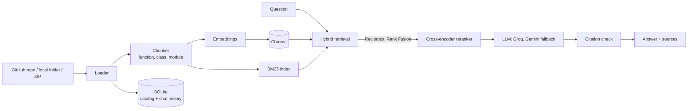

# GitContext: Codebase Intelligence Copilot

Ask questions about any public GitHub repository, local project, or ZIP and get answers grounded in the real code, with **evidence-checked citations** pointing to the exact files and line ranges.


## Why GitContext

Plain keyword search misses meaning, and plain vector search misses exact names. GitContext combines both, then reranks the candidates with a cross-encoder, so questions like *"How does Flask register routes?"* and *"Where is the dev server started?"* both land on the right code. Retrieval quality is measured, not assumed: the repo ships with an evaluation harness that compares BM25, vector, hybrid, and hybrid + reranking on manually labeled questions.


## Architecture



## Features

- **Flexible input**: local repository, public GitHub repository and branch, or ZIP upload
- **Beyond code**: indexes recent commits, pull-request descriptions/reviews, and bug/incident-style issues alongside files
- **Incremental indexing**: only changed and deleted files are re-indexed into persistent local Chroma
- **Hybrid retrieval**: vector similarity + BM25, fused with Reciprocal Rank Fusion, then cross-encoder reranking
- **Grounded answers**: Groq as primary LLM, Gemini as fallback; citations are validated against retrieved evidence
- **Streamlit chat UI**: streaming answers, per-repository chat history, response timing, expandable source cards
- **Repository insights**: architecture summary and local Python/JS/TS dependency view
- **Built-in evaluation**: Recall@K, Precision@K, hit rate, MRR, latency, and citation validity
- **Runs locally**: SQLite and Chroma data stay under `data/`; API keys come from `.env`

## Tech stack

| Layer | Tools |
|---|---|
| Backend | Python, FastAPI |
| Frontend | Streamlit |
| Retrieval | ChromaDB, BM25, Reciprocal Rank Fusion, cross-encoder reranker |
| Storage | ChromaDB (vectors), SQLite (catalog, chat history) |
| LLMs | Groq (primary), Gemini (fallback) |
| Ingestion | GitHub API, local files, ZIP |

## Quick start

Requires Python 3.10+.

```powershell
git clone https://github.com/Jasmin-IT/<repo-name>.git
cd <repo-name>
python -m venv .venv
.\.venv\Scripts\Activate.ps1          # macOS/Linux: source .venv/bin/activate
pip install -r requirements.txt
Copy-Item .env.example .env           # macOS/Linux: cp .env.example .env
```

Add at least one key to `.env` (needed only to generate answers; indexing and retrieval work without it):

```dotenv
GROQ_API_KEY=your_groq_api_key
GEMINI_API_KEY=your_gemini_api_key
```

Run the API and the UI in two terminals:

```powershell
uvicorn api:app --reload              # API at http://127.0.0.1:8000  (docs at /docs)
streamlit run frontend\app.py         # UI at http://localhost:8501
```

Set `API_BASE_URL` if the frontend should use a different API address. On first start, the embedding and reranking models may need to download.

## Usage

1. Paste a public GitHub URL, optionally pick a branch, or upload a ZIP.
2. Click **Load repository** and wait for indexing to finish.
3. Pick a suggested question or type your own. Expand the source cards to inspect the files behind each answer.
4. Switch projects from **Indexed repositories**.


## Indexing details and limits

- Public GitHub repositories only; private repositories are not supported.
- ZIP limits: 25 MB compressed, 100 MB uncompressed. Archives are validated for unsafe paths and symlinks and are not extracted to disk.
- Files over 1 MB and unsupported extensions are skipped. Virtual environments, dependency/build caches, generated output, and dataset folders are excluded.
- To limit GitHub API usage, history and issue context is bounded to the 5 most recent records per category and at most 10 comments per record. It is not a complete archive.
- AI query rewriting is off by default (saves an LLM call). Enable it in the UI or set `GITCONTEXT_QUERY_REWRITE=true` for CLI use.

## Evaluation

Retrieval metrics need repository-specific gold labels. Inspect chunk paths and line ranges first:

```powershell
python evaluate.py --repository-path "C:\work\my-project" --list-chunks
```

Create a dataset:

```json
[
  {
    "question": "Where is user input validated?",
    "expected": [
      { "file_path": "src/validation.py", "start_line": 10, "end_line": 24 }
    ]
  }
]
```

Run it:

```powershell
python evaluate.py --repository-path "C:\work\my-project" --eval-file "eval_sets\my-project.json"
python evaluate.py --repository-url "https://github.com/owner/project" --eval-file "eval_sets\project.json"
python evaluate.py --repository-path "C:\work\my-project" --eval-file "eval_sets\my-project.json" --rewrite
python evaluate.py --repository-path "C:\work\my-project" --eval-file "eval_sets\my-project.json" --answers
```

`--answers` also measures citation validity, overlap with gold labels, and end-to-end latency. Citation checks do not replace human review of answer correctness or hallucination resistance.

## Tests

```powershell
python -m unittest discover -s tests -v
```

chnology
[LinkedIn](https://www.linkedin.com/in/jasmin-nirmala-d-4353a02b5) | [GitHub](https://github.com/Jasmin-IT)
